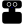
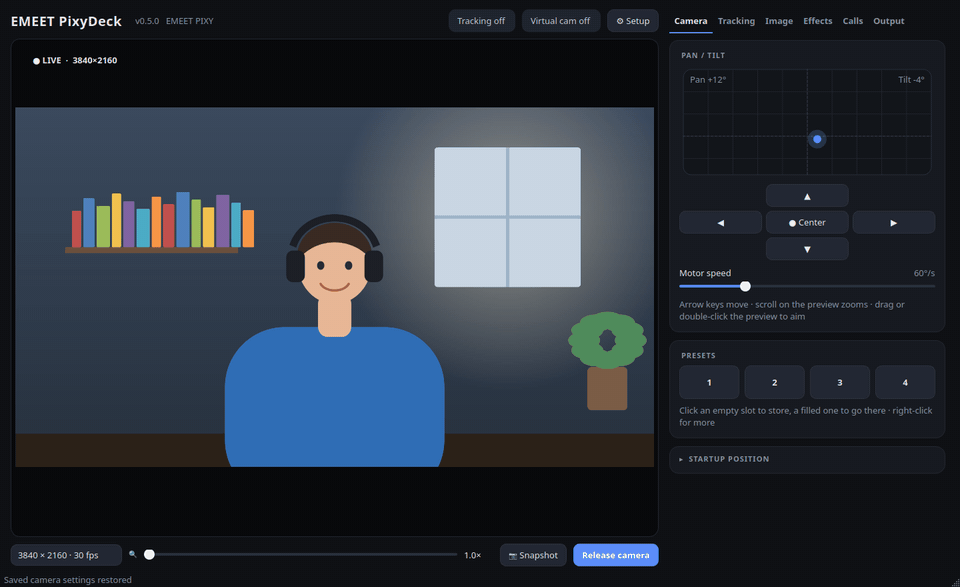

# EMEET PixyDeck

**La suite de contrôle Linux pour la webcam EMEET PIXY.** 
Orientation et zoom, l'IA de la caméra, cadrage automatique, flou d'arrière-plan par IA, fond vert, 
stabilisation et une caméra virtuelle pour Meet, Zoom, Teams et OBS – dans une seule application native.

[English](README.md) · [Deutsch](README.de.md) · **Français** · [Español](README.es.md)

> **Projet communautaire non officiel** – sans lien avec EMEET ni approuvé par EMEET. EMEET et PIXY sont des marques de leur propriétaire. Toutes les images montrent une scène de démonstration dessinée, rendue par la vraie application.

## Points forts

<table>
<tr>
<td width="50%"></td>
<td width="50%"></td>
</tr>
</table>

- 🎯 **IA embarquée de la PIXY** : suivi du visage, mode confidentialité, gestes, **mise au point par clic**, réduction de bruit du micro
- 🔍 **Zoom jusqu'à 4×** : zoom matériel quand la PIXY le permet, zoom numérique net au-delà – même en 4K
- 🪄 **Arrière-plan** : flou ou remplacement par IA sans fond vert ; détection automatique d'un fond vert
- 🎥 **Caméra virtuelle** *EMEET PIXY (PixyDeck)* avec tous les effets, pour toutes les applications vidéo
- 🫨 **Stabilisation**, 🔒 **minuterie de confidentialité**, 🎛️ **réglages d'image**, 🛠️ **assistant de configuration**

## Installation

| Système | Commande |
| --- | --- |
| **Ubuntu / Pop!_OS 24.04** | télécharger le `.deb` depuis les [releases](https://github.com/dalu951/pixydeck/releases), puis `sudo apt install ./pixydeck_*_amd64.deb` |
| **Arch / CachyOS / Manjaro** | télécharger `PKGBUILD` et `pixydeck.install` depuis la [dernière release](https://github.com/dalu951/pixydeck/releases/latest), puis `makepkg -si` (paquet AUR à venir) |
| **Toute distribution** | `git clone https://github.com/dalu951/pixydeck.git && cd pixydeck && ./install.sh` |

Lancez **EMEET PixyDeck** depuis le menu des applications ; la boîte de dialogue **⚙ Setup** corrige ce qui manque. Documentation détaillée (en anglais) : [installation](docs/en/installation.md) · [guide](docs/en/user-guide.md) · [dépannage](docs/en/troubleshooting.md) · [FAQ](docs/en/faq.md).

## Confidentialité et licence

Toute l'IA fonctionne **localement** ; aucune image ne quitte l'ordinateur. Issu d'un fork de [emeet-pixy-control](https://github.com/rolfobermaier/emeet-pixy-control) de Rolf Obermaier ([CREDITS.md](CREDITS.md)). Licence : **GNU GPL v3 only**.
