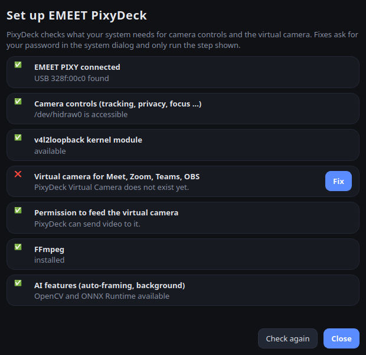

# Installation

[← README](../../README.de.md) · [English](../en/installation.md) · **Deutsch**

PixyDeck braucht Linux mit systemd, eine EMEET PIXY (USB `328f:00c0`) und – für die virtuelle Kamera – das Kernelmodul `v4l2loopback`.

## Ubuntu, Pop!_OS, Linux Mint (Basis 24.04)

1. `pixydeck_<version>_amd64.deb` von der [Release-Seite](https://github.com/dalu951/pixydeck/releases) herunterladen.
2. Mit apt installieren – FFmpeg, v4l-utils und `v4l2loopback-dkms` kommen automatisch mit:

   ```bash
   sudo apt install ./pixydeck_*_amd64.deb
   ```

3. **EMEET PixyDeck** im Anwendungsmenü starten.

Das Paket bringt seine Python-Bibliotheken (Qt, OpenCV, ONNX Runtime) in `/opt/pixydeck` mit und kommt den Python-Paketen des Systems nicht in die Quere. Der Dienst `pixydeck-virtual-camera` wird automatisch aktiviert.

## Arch Linux, CachyOS, EndeavourOS, Manjaro

```bash
yay -S pixydeck            # oder: paru -S pixydeck
```

Das AUR-Paket nutzt die offiziellen Arch-Pakete (`pyside6`, `python-opencv`, `python-onnxruntime`, …). Wie unter Arch üblich werden Dienste nicht automatisch aktiviert: Einmal in PixyDeck **⚙ Setup** öffnen und bei *Virtuelle Kamera* auf **Fix** klicken – oder `sudo systemctl enable --now pixydeck-virtual-camera.service` ausführen.

Bringt dein Kernel kein `v4l2loopback` mit, zusätzlich `v4l2loopback-dkms` und die passenden Kernel-Header installieren.

## Jede andere Distribution (Installationsskript)

Python 3.10+, `python3-venv`, `v4l-utils`, FFmpeg und `v4l2loopback` (Modul + `v4l2loopback-ctl`) über den Paketmanager installieren, dann:

```bash
git clone https://github.com/dalu951/pixydeck.git
cd pixydeck
./install.sh
```

Das Skript installiert PixyDeck in eine eigene Python-Umgebung unter `~/.local/share/pixydeck`, legt den Menüeintrag an und fragt einmal per `sudo` nach dem Passwort, um udev-Regeln, Polkit-Aktion, Setup-Helfer und den Dienst für die virtuelle Kamera einzurichten. Eine ältere *emeet-pixy-control*-Installation wird ersetzt, ihre Einstellungen werden übernommen.

## Erster Start

Beim Start prüft PixyDeck das System. Fehlt etwas, öffnet sich der Dialog **⚙ Setup**:



| Prüfung | Was „Fix“ tut |
| --- | --- |
| Kamerasteuerung | wendet die udev-Regel an, damit deine Desktop-Sitzung mit der PIXY sprechen darf |
| Kernelmodul v4l2loopback | nicht automatisch lösbar – das im Dialog genannte Paket installieren |
| Virtuelle Kamera | lädt das Modul und aktiviert `pixydeck-virtual-camera.service` |
| Recht, die virtuelle Kamera zu beliefern | normalerweise per udev; als Rückfall wirst du zur Gruppe `video` hinzugefügt (danach ab- und wieder anmelden) |

Jede Reparatur fragt im Polkit-Dialog deines Systems nach dem Passwort und führt nur den angezeigten Schritt aus – sonst nichts.

## Aktualisieren

- **.deb:** das neuere `.deb` genauso installieren.
- **AUR:** dein AUR-Helfer aktualisiert es mit dem System.
- **Skript:** `git pull && ./install.sh`.

## Deinstallieren

| Installiert über | Befehl |
| --- | --- |
| .deb | `sudo apt remove pixydeck` |
| AUR | `sudo pacman -R pixydeck` |
| install.sh | `./uninstall.sh` (mit `--purge` werden auch die Einstellungen gelöscht) |

Die Einstellungen liegen in `~/.config/pixydeck/pixydeck.conf`. Systempakete wie FFmpeg oder v4l2loopback werden nie entfernt.
