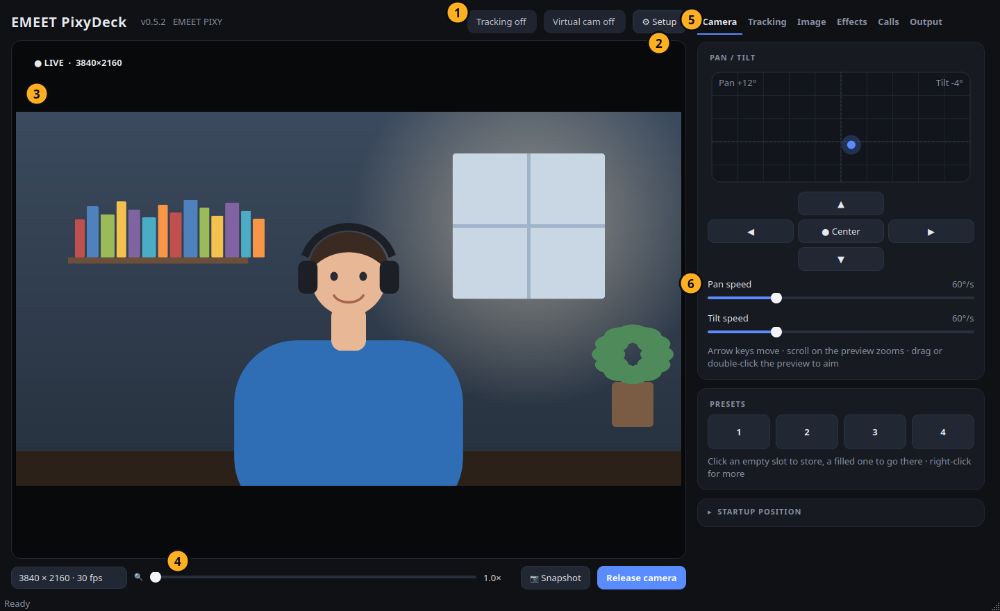
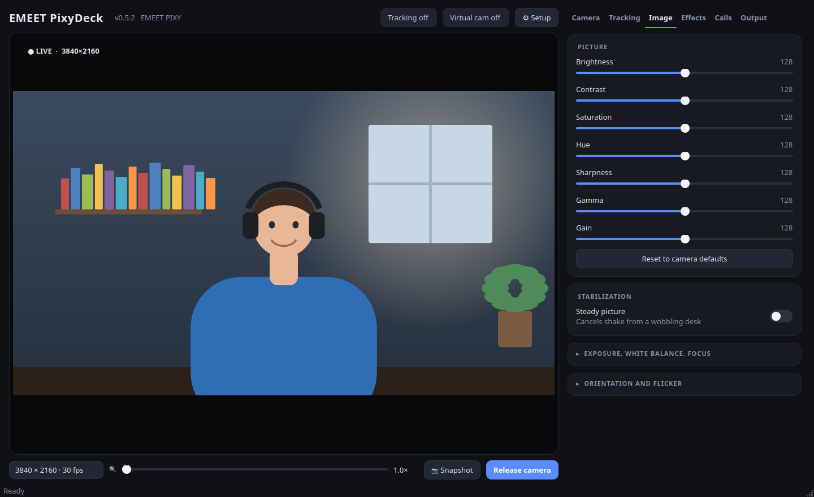
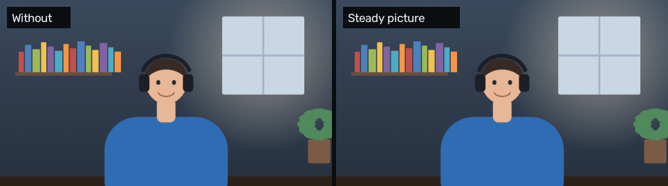
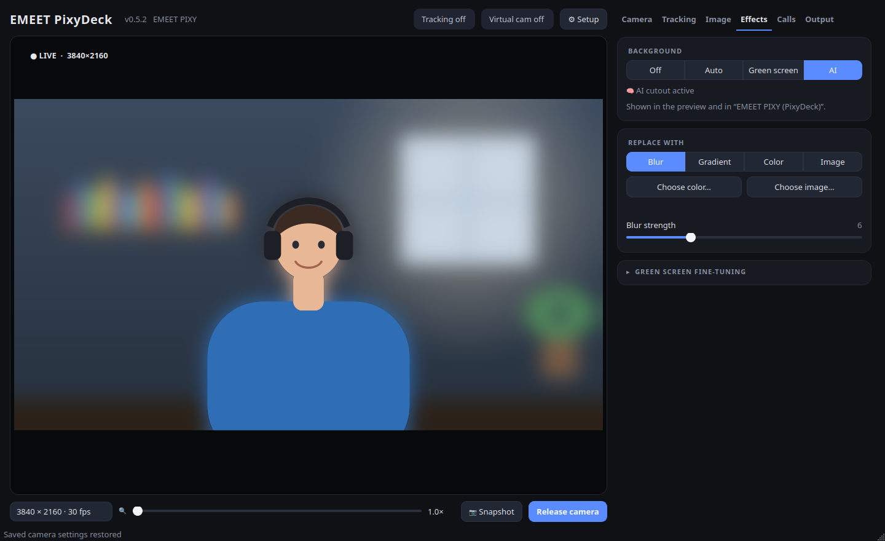
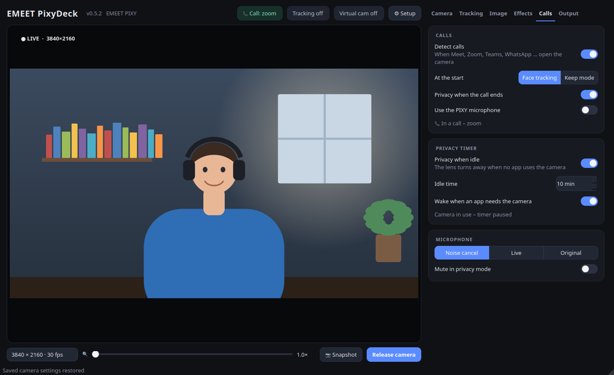

# GUI tour

[← README](../../README.md) · **English** · [Deutsch](../de/gui-tour.md)

Every control in EMEET PixyDeck, tab by tab. For background and tips see the [user guide](user-guide.md).

## The window

| | What it is | What you can do |
| --- | --- | --- |
| **①** | Status pills | *Tracking off / Face tracking / Privacy*, *Virtual cam on/off*, and – while another app uses the camera – *In use: app* or *📞 Call: app* |
| **②** | ⚙ Setup | Opens the setup check. It turns into **⚠ Setup** when permissions, the kernel module or the virtual camera need fixing |
| **③** | Preview | Drag to aim (or to move the crop when zoomed in) · double-click to centre a spot · scroll to zoom · with *Click point* focus, click to focus. The HUD shows LIVE, resolution and zoom |
| **④** | Toolbar | Capture resolution · zoom slider (1×–4×) · **Snapshot** (saved to `~/Pictures/EMEET PIXY`) · **Release camera** / **Resume preview** |
| **⑤** | Tabs | Camera · Tracking · Image · Effects · Calls · Output – PixyDeck reopens the last one |
| **⑥** | Cards | Groups of settings. Cards marked ▸ are folded, ▾ open; click the title to fold or unfold them – PixyDeck remembers it |

Hover over a control for a short explanation.

## Camera

| Control | What it does |
| --- | --- |
| **Pan / tilt pad** | Click or drag to aim; the dot is where the camera points. Tilt stops at −52° (lower only parks the camera) |
| **▲ ◀ ▶ ▼** | Hold to glide – faster the longer you hold. Arrow keys do the same |
| **● Center** | Pan and tilt to 0° and zoom out (key `C`) |
| **Pan speed / Tilt speed** | How fast the motors turn, 1–240 °/s. The camera's own tracking uses them too: raise *Tilt speed* if it loses you when you stand up or sit down. PixyDeck sets them again if the camera falls back to its own speed |
| **Presets 1–4** | Click an empty slot to store the current position, a filled one to go there. Right-click: *Go to preset*, *Store current position here*, *Use as startup position*, *Clear*. Keys `1`–`4` recall, `Ctrl+1`–`4` store |
| ▸ **Startup position** → *When PixyDeck starts* | *Last position* or one of the presets |
| ▸ **Startup position** → *Save as camera power-on position* | Stores the current pan/tilt in the camera itself: it powers on there, also without PixyDeck and on other computers |

## Tracking

| Control | What it does |
| --- | --- |
| **Camera tracking** | *Off* · *Face tracking* – the PIXY turns to follow you · *Privacy* – the lens turns away (key `T` toggles tracking, `P` privacy) |
| **Keep in frame** | What tracking follows: *Auto*, *Face* or *Upper body* |
| **Find me when I sit down** | The camera tilts too slowly to follow you when you sit down and then stops looking. PixyDeck learns where you usually sit and tilts back there after about a second without your face. Needs PixyDeck's own picture (preview or virtual camera) |
| **Gesture control** | Steer the camera with hand gestures; changes appear in PixyDeck within about three seconds |
| **Focus** | *Center* · *Face* · *Click point* – click anything in the preview and the PIXY's second lens focuses there (yellow marker) |
| ▾ **Auto-framing** → *Digital auto-framing* | Zooms and follows faces in software (key `F`). While the camera's own tracking runs, it only zooms and leaves the aiming to the camera |
| ▾ **Auto-framing** → *Wide / Medium / Tight* | How close |
| ▾ **Auto-framing** → *Show detected faces* | Draws the detection boxes in the preview |

## Image

| Control | What it does |
| --- | --- |
| **Picture** | Brightness, contrast, saturation, hue, sharpness, gamma, gain – sent to the camera as you drag |
| **Reset to camera defaults** | Puts every picture setting back to the camera's own default |
| **Steady picture** | Removes shake from a wobbling desk or monitor. Uses an 8 % digital reserve; you moving and deliberate pans pass through |
| ▸ **Exposure, white balance, focus** | *Auto white balance* / *Temperature*, *Auto exposure* / *Exposure time*, *Autofocus* / *Focus*: switch an automatic off to set it by hand · *Backlight compensation* · *Lock exposure / white balance / focus* – hold the current value, so the picture does not pump when you lean in or hold something up |
| ▸ **Orientation and flicker** | *Mirror horizontally* · *Flip vertically* · *Auto-rotate when upside down* (ceiling or under-monitor mounting) · *Anti-flicker* off / 50 Hz / 60 Hz – match your mains frequency if lights flicker |

## Effects

| Control | What it does |
| --- | --- |
| **Background** | *Off* · *Auto* – green screen while one is in view, AI otherwise · *Green screen* · *AI* – cuts you out of any room (more CPU) |
| **Replace with** | *Blur* (with *Blur strength*) · *Gradient* · *Color* (*Choose color…*) · *Image* (*Choose image…*) |
| ▸ **Green screen fine-tuning** | *Similarity* – raise if green remains, lower if parts of you disappear · *Edge softness* · *Green spill removal* – takes the green tint off hair and edges |

Effects show in the preview, in snapshots and in *EMEET PIXY (PixyDeck)*. An app that opens the real camera directly does not see them.

## Calls

| Control | What it does |
| --- | --- |
| **Detect calls** | Notices when Meet, Zoom, Teams, WhatsApp, OBS … open the camera. A quick device check by a browser does not count |
| **At the start** | *Face tracking* – turn tracking on · *Keep mode* – only leave privacy |
| **Privacy when the call ends** | The lens turns away a few seconds after the last app lets go |
| **Use the PIXY microphone** | Makes the PIXY the default microphone during the call and switches back afterwards |
| **Privacy when idle** / **Idle time** | Enter privacy after the chosen minutes without any app using the camera (paused while the preview is visible) |
| **Wake when an app needs the camera** | Leave privacy as soon as an app opens the camera |
| **Microphone** | The PIXY's sound: *Noise cancel* · *Live* · *Original* |
| **Mute in privacy mode** | Mutes the PIXY microphone while the lens is turned away |

## Output

| Control | What it does |
| --- | --- |
| **Processed** | The virtual camera shows exactly what PixyDeck shows – zoom, framing, background, stabilization. *Output size* sets its resolution |
| **Direct** | The camera passes through unchanged, lowest CPU; *Frame rate* – 30 fps keeps hardware zoom working at 1080p |
| **Start / Stop** | Runs the virtual camera |
| **Start with PixyDeck** | On by default: the virtual camera is always there, so apps can stay set to it. While PixyDeck has no picture it shows a waiting screen |
| ▸ **Direct use by other apps** | When to use *Release camera* instead |

## Setup dialog

Lists every requirement with ✅, ⚠️ or ❌. **Fix** buttons run one fixed, polkit-authorised action – camera permissions, the virtual camera service or the video group; *Check again* re-runs the checks.
