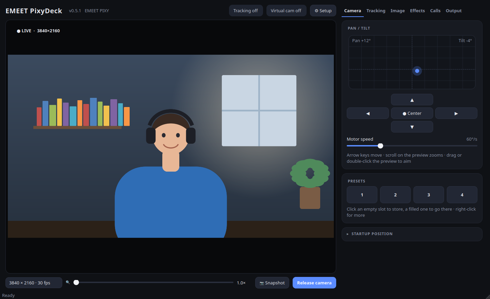
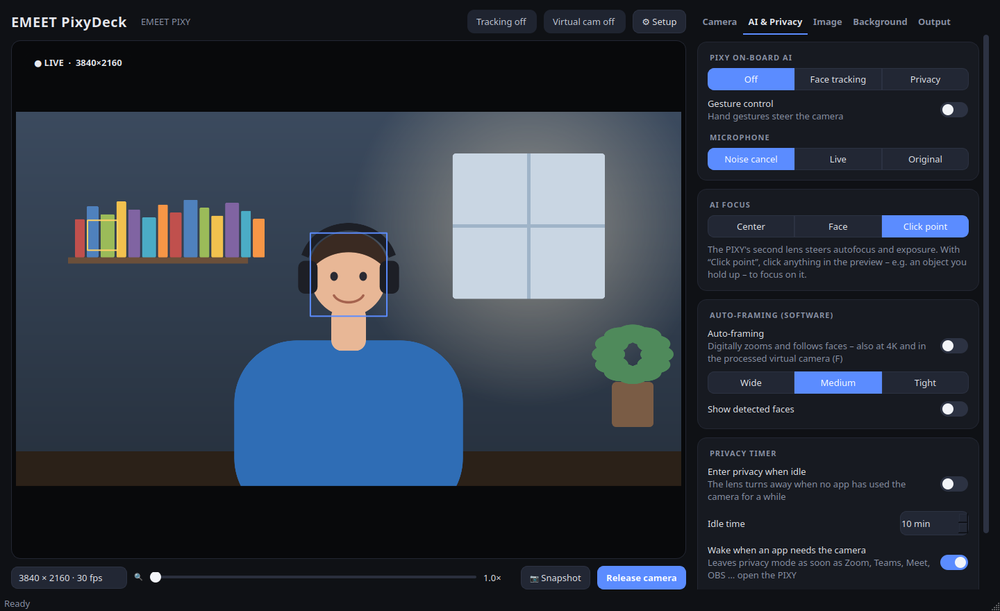
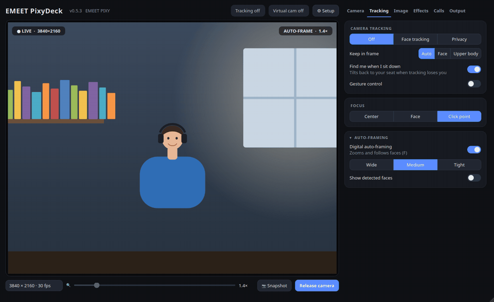
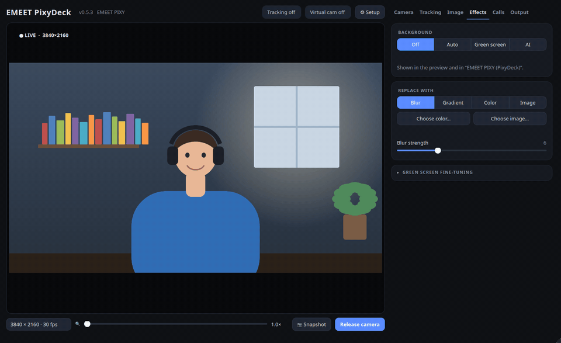
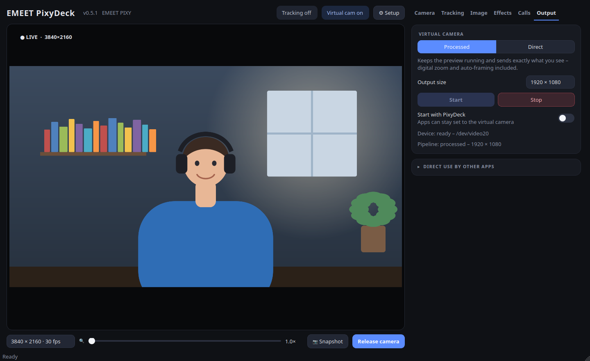

# User guide

[← README](../../README.md) · **English** · [Deutsch](../de/benutzerhandbuch.md)

The window has the live preview on the left and five tabs on the right. The header shows the camera, status pills (tracking, virtual camera, apps using the camera) and **⚙ Setup**.

## Camera tab – aim, zoom, presets

- **Pan/tilt pad:** click or drag to aim; the dot shows where the camera points. Tilt is limited to −52° … +90° because lower angles only park the camera.
- **Arrow buttons / arrow keys:** hold to glide; movement accelerates the longer you hold.
- **On the preview:** drag to aim (or to move the digital crop when zoomed), double-click to centre a spot, scroll to zoom.
- **Zoom slider (1×–4×):** uses the PIXY's hardware zoom (up to 1.5×) where the video mode supports it – below 1080p and at 1080p30 – and digital zoom beyond.
- **Presets 1–4:** click an empty slot to store the current position, a filled one to recall it; right-click for more. *Position at startup* chooses where the camera goes when PixyDeck starts.

## AI & Privacy tab

- **PIXY on-board AI:** *Off*, *Face tracking* (the camera follows you physically) or *Privacy* (the lens turns away). Gesture control and the microphone's DSP mode (noise cancel, live, original) are here too. Changes made by hand gestures appear in the app within about three seconds.
- **AI focus:** *Center*, *Face*, or *Click point* – then click anything in the preview, e.g. an object you hold up, and the PIXY's second lens focuses on it (yellow marker).
- **Auto-framing (software):** digitally zooms and follows faces. *Wide*, *Medium*, *Tight* set how close; *Show detected faces* draws the detection boxes.
- **Privacy timer:** enters privacy mode after the idle time, wakes up automatically as soon as another app (Zoom, Teams, Meet, OBS …) opens the camera, and can mute the PIXY microphone while in privacy. The timer pauses while the preview is visible.

## Image tab

Brightness, contrast, saturation, hue, sharpness, gamma and gain; automatic or manual white balance, exposure and focus; backlight compensation; **stabilization** (*Steady picture*, uses an 8 % digital reserve to cancel shake); mirror, vertical flip and auto-rotate for upside-down mounting; anti-flicker (50/60 Hz). *Reset picture* restores the camera defaults.

## Background tab

| Mode | What happens |
| --- | --- |
| **AI** | Robust Video Matting cuts you out of any room (up to ~30 fps, more CPU) |
| **Green screen** | keys the exact shade detected at the picture's edges; fine-tune similarity, edge softness and spill removal |
| **Auto** | green screen while one is in view, AI otherwise |

Fill with **blur**, a **gradient**, a **colour** or your own **image**. Effects appear in the preview, in snapshots and in the processed virtual camera.

## Output tab – using PixyDeck in other apps

| Option | When to use |
| --- | --- |
| **Processed virtual camera** | Select *PixyDeck Virtual Camera* in Meet, Zoom, Teams or OBS. Everything you see in PixyDeck – zoom, auto-framing, background, stabilization – is what others see. |
| **Direct virtual camera** | Lowest CPU: FFmpeg forwards the camera unchanged; hardware zoom only. Choose 30 fps at 1080p to keep hardware zoom. |
| **Release camera** | Other apps open the physical EMEET PIXY directly; PixyDeck keeps controlling PTZ, AI and picture settings. |

**Snapshot** saves the current view (including effects) to `~/Pictures/EMEET PIXY`.

## Keyboard shortcuts

<!-- AUTO-GENERATED:shortcuts -->
| Key | Action |
| --- | --- |
| Arrow keys | Pan / tilt while held |
| `+` / `=` | Zoom in |
| `-` | Zoom out |
| Mouse wheel on the preview | Zoom |
| `C` | Center camera and reset zoom |
| `F` | Toggle auto-framing |
| `T` | Toggle face tracking |
| `P` | Toggle privacy mode |
| `S` | Save snapshot |
| `1`–`4` | Recall preset |
| `Ctrl+1`–`Ctrl+4` | Store preset |
| `Ctrl+Q` | Quit |
<!-- /AUTO-GENERATED:shortcuts -->

## Command line

<!-- AUTO-GENERATED:cli -->
`pixydeck-cli` is on your `PATH` with the .deb and AUR packages; after `./install.sh` it is `~/.local/share/pixydeck/venv/bin/pixydeck-cli`.

| Command | Description |
| --- | --- |
| `pixydeck-cli status` | Show device, pan, tilt and zoom |
| `pixydeck-cli center` | Pan/tilt to 0° and zoom out |
| `pixydeck-cli left` | Pan 2° left |
| `pixydeck-cli right` | Pan 2° right |
| `pixydeck-cli up` | Tilt 2° up |
| `pixydeck-cli down` | Tilt 2° down |
| `pixydeck-cli pan DEGREES` | Pan to an absolute angle (-150…150) |
| `pixydeck-cli tilt DEGREES` | Tilt to an absolute angle (-52…90) |
| `pixydeck-cli zoom 100-150` | Set hardware zoom |
| `pixydeck-cli zoom-in` | Hardware zoom +10 |
| `pixydeck-cli zoom-out` | Hardware zoom -10 |
| `pixydeck-cli track` | Enable face tracking |
| `pixydeck-cli idle` | Disable tracking |
| `pixydeck-cli privacy` | Enter privacy mode |
| `pixydeck-cli gesture-on` | Enable gesture control |
| `pixydeck-cli gesture-off` | Disable gesture control |
| `pixydeck-cli audio nc\|live\|org` | Microphone mode: noise cancel, live, original |
| `pixydeck-cli auto-privacy SECONDS` | Camera-side auto-privacy delay (0 = off; experimental) |
| `pixydeck-cli flicker off\|50\|60` | Anti-flicker frequency |
<!-- /AUTO-GENERATED:cli -->
